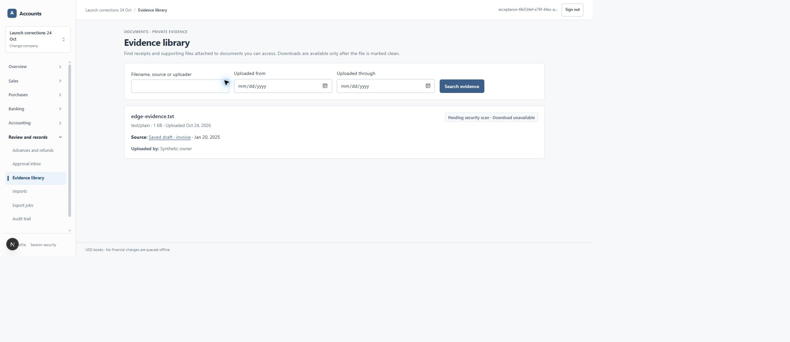
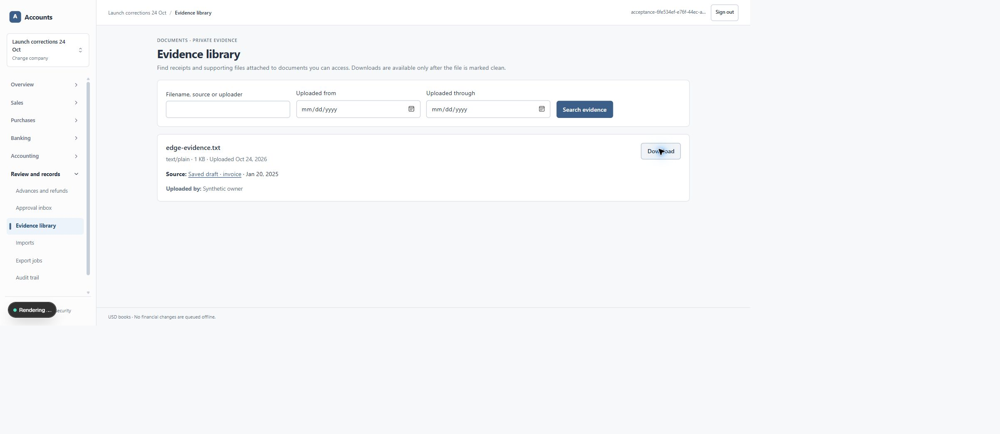

# Authorized evidence uploads — 24 October 2026

Implementation `956a6d7ade7e6d5c476d44f7952067773fda3181`, scoped to US-068 / #27 and the evidence library. Stacked on PR #192. Production is unchanged.

Saved drafts had no upload control. The completion service also attempted private object I/O before its first permission-checked RPC. Factory creation of a request client does not authenticate an actor. Migration **0126** adds a live actor, intent owner, company, metadata, source state and source capability preflight. Completion rechecks those conditions with the source locked; runtime receives only function execution, not private table/helper access. Retries retain one attachment, one link and one audit and return the actual scan status. A concurrent change after preflight can leave quarantined bytes, but cannot authorize a link or download when final validation fails.

The browser now offers supporting files on eligible saved drafts. It hashes the chosen file, binds completion to the returned same-company intent, prevents double submission and retains the same file/intent after an uncertain response. HTTP handlers authenticate and validate company context before reading a bounded body, including chunked input. The browser limit is 4 MiB; the existing API maximum remains 10 MiB. No public object URLs or artificial clean verdicts are used.

Actual Edge testing found the evidence library rejected PostgreSQL `bigint` file sizes, returned as strings. The response parser now validates and converts only bounded integer sizes. It also accepts an absent posted source date without inventing a date. **0127** aligns upload-day filters with the company's stored timezone; timestamps use that timezone, while source accounting dates remain calendar dates.

| Check | Result |
| --- | --- |
| `npm run test:application` | 364/364 passed, no skips |
| `npm run lint`, `npm run typecheck` | Passed |
| Optimized webpack build | See attached build log |
| Restricted-role/private S3/real ClamAV upload suite | 6/6 passed on the upgraded isolated database; fresh-install result in attached receipt |
| Real Auth.js HTTP security suite | 14/14 passed, no skips; anonymous, foreign company, insufficient capability and stale context cause no object write |
| Edge upload → quarantine → real scan → download | Passed; actual downloaded 58-byte file matches SHA-256 `a54741d5adf24ac5a0f0974849c16eb22d261032ecd8a7fdbc3fa2543dfa28d0` |
| Isolated 0126/0127 upgrades | Existing financial fingerprints unchanged; receipts preserve the applied checksums |

Exact integration commands (private profiles are deliberately excluded):

```text
node --env-file=<isolated-profile> output/launch/2026-10-24/apply-pending.mjs 0126_authorize_attachment_storage_writes.sql
node --env-file=<isolated-profile> output/launch/2026-10-24/apply-pending.mjs 0127_company_local_evidence_dates.sql
AMS_SCANNER_TESTS=real-clamav CLAMAV_HOST=127.0.0.1 CLAMAV_PORT=3311 node --env-file=<isolated-profile> --conditions=react-server --test tests/database/attachment-upload-authorization.test.mjs
node --env-file=<isolated-profile> --conditions=react-server --test tests/database/http-security.test.mjs
node --env-file=<isolated-profile> scripts/run-next.mjs build apps/web --webpack
```

PowerShell used separate environment assignments. Both databases are explicitly isolated on the recovery test branch; storage is the private `ams-recovery-drill` bucket. Privileged fixture changes set synthetic company timezone/upload timestamps only to exercise a midnight boundary. Financial commands and denials run under the restricted runtime role. The daemon is ClamAV 1.5.4, signature 28162, bound only to loopback. Edge testing used a synthetic account and a saved draft with no journal. A manually invoked restricted worker performed the real scan; this is not evidence of a production scheduler.

Before the real verdict, Edge showed “Pending security scan · Download unavailable”:



After the verdict, its permission-checked download produced the exact original bytes:



[Logs and receipts](evidence/authorized-upload-2026-10-24/README.md) include the actual Edge observations and byte comparison. No live production financial data, credentials or private object endpoints are published. This is labelled AI implementation/code/security review, not independent security certification. Production worker hosting, scheduling, signature maintenance and the separate production migration/deployment gate remain outstanding. Paid billing and privileged support remain deferred. Opening historical due dates and dormant-year closing remain separate accounting blockers.
