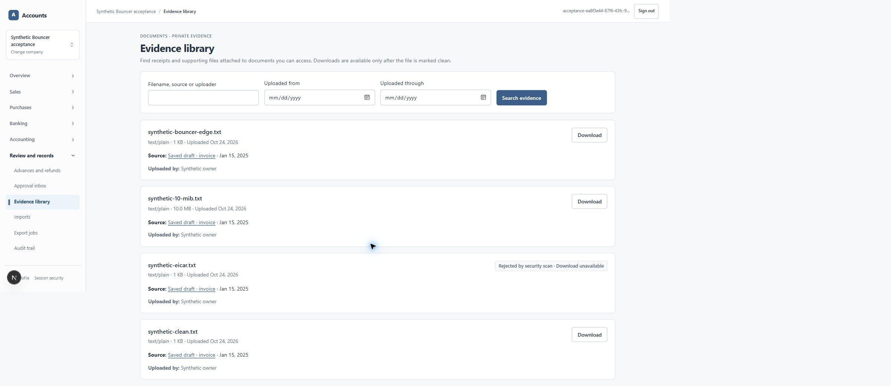

# Replaceable Bouncer scanner — 24 October 2026

PR #200, refs #27 / US-068, based on #199 and its pending dependency stack. Adapter implementation `b6b1e9c09f59e18a5e06f35486e1848e01a0057d`; storage/retry correction `ada66f722ab68501b937d49072fb1e2154246b5a`; native download correction `15e472e6b3590343eac85c158b8fa492d808cc41`. The owner selected Bouncer's free tier, authorized creating the named test key and requested synthetic tests before activation. The RAM upgrade, billing and privileged support remain deferred.

The scanner now selects an explicit adapter. Existing configuration still defaults to ClamAV. Bouncer v2 uses an anonymous filename, a fixed authenticated API origin and an explicitly approved regional upload bucket; redirects and arbitrary upload destinations are refused. The API key never goes to S3 or browser code. Signed upload fields exist only in memory. Remote errors are reduced to safe codes. A release requires the exact scan id, SHA-256, byte count, clean verdict, empty threats and clean engine decisions. No provider fallback or paid upgrade occurs automatically.

Migration **0132** adds a private organization/attachment/provider/digest checkpoint and three worker-only lease-fenced routines, and extends the existing failure routine for pending/quota deferral. It grants no financial DML. Canonical SHA-256: `577dfb4f9cff84e771d891d6aba2d3deebed048683ca4a137cb34d781d25ecad`. It was applied only to two isolated databases using the guarded old-receipt/checksum runner, with unchanged six-table financial fingerprints. The second database began empty through 0124 and was incrementally upgraded with synthetic fixtures through 0132; it is not an untouched 0132 installation. Production remains at 0123.

Saved cloud references resume by GET after a process restart, without fetching/uploading the same private bytes again. A new submission verifies the actual bytes first; authorized downloads independently check the bytes and current permission again. Unknown create/upload outcomes stay quarantined rather than blindly creating another scan. Pending and exhausted-quota cases preserve the ordinary retry budget; quota defers to the next UTC month. Paid/unknown plans fail closed. No real quota exhaustion was manufactured.

Real large-file tests exposed unbounded private-storage waits. GET now bounds actual streamed bytes to the descriptor and uses a 15-second header/body deadline, with at most two fresh-connection retries (45 seconds total). Attachment PUT retains its conditional write and digest-safe retry, with a 30-second deadline. The 90-second process watchdog and database leases were not extended. A final object-read failure occurs before provider submission, abandons only the definitely unsubmitted reservation, and queues the existing retry while preserving quarantine.

| Check | Actual result |
| --- | --- |
| Application suite / final code CI | **388/388 passed**, no skips |
| Focused provider/download/body unit suites | **19/19 passed**, including stalls, overflow, partial bytes, result mismatch, SSRF, quota and ambiguous submission |
| Checkpoint/tenant/digest/lease suite, upgraded database | **7/7 passed**, ordinary runtime and worker direct-DML denied |
| Same suite, fresh-install lineage | **7/7 passed**, no skips |
| Real Bouncer in Linux containers | **4/4 passed**: clean text, harmless EICAR string and 10 MiB text; real private objects and restricted worker login |
| Existing real ClamAV regression after stream correction | **5/5 passed**, including infected/unscanned denial, exact clean download, outsider denial and outage retry |
| TypeScript / ESLint / optimized Next.js build | Passed; receipts attached |
| Compose configuration / deployment script shell syntax | Exit 0; neither command activated production |
| Real Edge flow | Synthetic sign-in → company selection → supporting-file upload → pending quarantine → real Bouncer scan → evidence library → ordinary-click small and 10 MiB downloads; exact byte counts and hashes verified |

The final Bouncer run created **exactly three provider scans**, one per synthetic file. Every file resumed the same saved id in a new container; EICAR stayed rejected and unavailable to download. Clean results and the 10 MiB download were verified through ordinary authorized server code with exact hashes; outsiders remained denied. These cases created only drafts, with zero journal/line/open-item/allocation counts throughout. A separate Edge worker run preserved a six-table financial fingerprint and consumed exactly one scan for the browser-uploaded file. No real customer file, invoice recipient or financial posting was used.

The single-scanner candidate runs non-root, read-only, with dropped capabilities, no published ports, a private bridge, secret-file credentials, CPU 0.25 and a **192 MiB** memory cap. Six final scan/poll container runs exited without OOM. Maximum measured cgroup high-water mark was **179,458,048 bytes (171.1 MiB)**; this is not a worldwide capacity or host-memory guarantee. A separate stalled private-object probe reached 60 seconds without OOM at low CPU, and the bounded implementation retrieved those bytes in 28.5 seconds. Read-only inspection of the existing shared VM found 380,740 KiB available and healthy POS services; the activation script still requires at least 320 MiB currently available. No VM, POS service, production secret or deployment was changed.

Actual account usage after all probes was **16/500 on the free tier**, resetting 1 November 2026 UTC. Only the named test key was created, saved into ignored private configuration and dismissed from its one-time display. Provider account screenshots, API key values, signed fields, SMTP and storage credentials are excluded from public evidence. The [runbook](../../infra/jobs/README.md) and [ADR 0008](../adr/0008-attachment-scan-provider.md) record the provider's processing region, retention, terms, free quota, switching and failure investigation.



The screenshot contains synthetic company/contact data and was visually inspected. [Pending-scan observation](evidence/bouncer-scanner-2026-10-24/bouncer-edge-quarantine.png) was captured before the browser-upload worker ran. The downloaded browser file hash was `c5fa252e6b25fefdd72daf1b5a1980730f519d7782e420620bffb9e7b1df1e29`. EICAR has no download link. The browser's existing zoom was preserved; no viewport override was added. Focusing the test tab through the supported browser control resolved screenshot timeouts.

The first **ordinary 10 MiB Edge click did not save a file**, confirmed by the owner. An earlier small-file check used the browser's download helper and did not exercise ordinary link navigation. Investigation found attachment links using `next/link`: the installed Next.js implementation intercepts same-origin clicks as navigation unless marked for download. The evidence library, upload result and approval attachment links now use native `<a download>` anchors, preserving the existing authorized endpoint and safe response headers. After reload, ordinary Edge clicks saved both the 10 MiB file and fresh 68-byte browser upload; the evidence page stayed open and EICAR still had zero download links. The large file hash was `eb6183addde05c2196ce25e6fa34a4baf20f9bf30d33892f452a9a1e88c9a472`. See [native-click receipts](evidence/bouncer-scanner-2026-10-24/bouncer-edge-downloads.json). No helper fetch substitutes for this final click check.

Internal `edge://downloads` inspection was rejected by browser URL policy. It was not worked around: the final result uses the permitted application UI, its download event and the actual saved synthetic bytes. Browser uploads retain the existing 4 MB transport limit. The upload-result and approval links received the same native-anchor correction; their complete separate UI journeys were not rerun in this slice.

Exact checks, using ignored isolated profiles (PowerShell assigns the shown environment variables separately):

```text
node --env-file=output/recovery/2026-10-21/final.private.env output/launch/2026-10-24/apply-pending.mjs 0132_attachment_scan_providers.sql
node --env-file=output/launch/2026-10-24/fresh.private.env output/launch/2026-10-24/apply-pending.mjs 0132_attachment_scan_providers.sql
node --conditions=react-server --env-file=output/recovery/2026-10-21/final.private.env --test tests/database/scan-provider-checkpoints.test.mjs
node --conditions=react-server --env-file=output/launch/2026-10-24/fresh.private.env --test tests/database/scan-provider-checkpoints.test.mjs
AMS_SCANNER_TESTS=real-bouncer-docker AMS_JOBS_TEST_IMAGE=ams-jobs:bouncer-durable node --conditions=react-server --env-file=output/launch/2026-10-24/fresh.private.env --env-file=output/launch/2026-10-24/bouncer.private.env --test tests/database/bouncer-scanner.test.mjs
AMS_SCANNER_TESTS=real-clamav ATTACHMENT_SCAN_PROVIDER=clamav CLAMAV_HOST=127.0.0.1 CLAMAV_PORT=3311 node --conditions=react-server --env-file=output/recovery/2026-10-21/final.private.env --test tests/database/attachment-scanner.test.mjs
node --conditions=react-server --test tests/application/storage-body.test.ts tests/application/artifact-download.test.ts tests/application/bouncer.test.ts
npm run test:application
npm run typecheck
npm run lint
node --env-file=output/recovery/2026-10-21/final.private.env scripts/run-next.mjs build apps/web --webpack
docker build -f infra/jobs/Dockerfile -t ams-jobs:bouncer-durable .
AMS_JOBS_IMAGE=ams-jobs:bouncer-reviewed docker compose -f infra/jobs/compose.bouncer.yml config --quiet
docker run --rm --network none --entrypoint sh --mount type=bind,source=F:/accounts-management-solution/infra/jobs/deploy-bouncer.sh,target=/deploy-bouncer.sh,readonly ams-jobs:bouncer-reviewed -n /deploy-bouncer.sh
node --env-file=output/launch/2026-10-24/fresh.private.env --env-file=output/launch/2026-10-24/bouncer.private.env output/launch/2026-10-24/scan-edge-file.mjs
node output/launch/2026-10-24/publish-bouncer.mjs
node output/launch/2026-10-24/verify-edge-downloads.mjs
```

`npm run test:database:scan-checkpoints` and `test:database:bouncer` expose the committed suites. Real tests require the private bucket, isolated target, restricted logins and explicit real-provider opt-in. The Linux suite requires no competing eligible scan jobs. Fixture administration prioritizes only its own synthetic attachment, and negative fixtures are deferred while remaining quarantined. The initial checkpoint fixture run also leased an old unrelated synthetic pending job through an overly broad claim; it did not upload bytes to Bouncer or change financial facts. The final fixture claims one prioritized own job.

Failed receipts are preserved, including the Node strip-only constructor error, missing `NODE_ENV` in a test input type, the first large worker deadline, the long acceptance timeout, and the later bounded download failure before allowing the third safe GET attempt. The first run printed an incomplete fixture summary after a failed subtest; that run remained failed. The suite now requires every case to pass before emitting its acceptance receipt. The final **durable** receipt is the passing provider result, and **native-download** receipts cover the final web correction; no earlier failure is represented as green.

This is AI engineering/security review under #115. It does not establish production migration/activation, a new full database/object recovery drill, independent accountant/legal certification, monitored production operations, pilot use or measured global capacity. Production still needs its authorized backup/migration/dependency/deployment sequence; never restore older books over newer transactions. The original full ClamAV jobs topology and RAM gate remain intact. No global-launch-ready claim is made.
