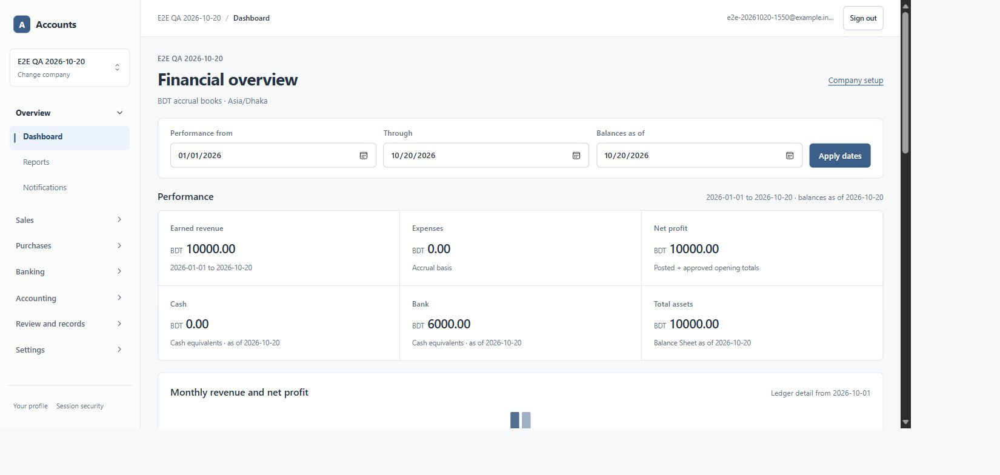

# Separate dashboard cash and bank balances

Requested scope: replace the Financial overview's combined Cash and bank card with separate Cash and Bank balances. Related: US-062 (#87), UI-06 and FR-16. This is a bounded amendment to the existing dashboard, not completion of the broader dashboard/golden-ledger acceptance gate. US-021 (#44) remains blocked.

Implementation commit: `6c67b5c461d7202c9612963aca3c608c9bbf8e61`. [PR #182](https://github.com/wdmahbubur/accounts-management-solution/pull/182) records the final head and checks. The base is the merged PR #181 tree, `1e19fcc78a4c4baf15902c6184a2822a8124cdcc`, including the existing shared reports and dashboard routines.

## Behavior and contract

- Cash and Bank are separate cards. Standard headline metrics form two rows of three on desktop; existing narrow-screen grid rules remain in place.
- `liquidity.balances_by_kind` adds `cash`, `bank`, `mobile_wallet` and `payment_clearing` entries, each with an exact two-decimal `balance` string and numeric `account_count`.
- Migration `0101_dashboard_cash_bank_split.sql` groups the closing account balances already returned by `read_cash_flow_snapshot`. It preserves the same as-of date, transaction cutoff, cash-equivalent designation and archived-account history. It performs no financial DML and changes no tables or grants.
- Wallet and clearing equivalents receive separate cards when present. They are never folded into Cash or Bank. All four category balances reconcile to the original `closing_cash_equivalents`, which remains available to existing consumers.
- Only `reports.read` callers receive liquidity data. A report reader does not need `banking.read`; sales-only callers receive the existing reduced dashboard without financial liquidity/performance data.
- Both new cards link to the dated cash-flow account breakdown. The report section has a stable anchor. The existing report money formatter preserves valid large balances instead of silently substituting zero.
- Until migration 0101 is available, the UI retains the prior combined card instead of inventing two zero balances. Roll out the additive read model before the application.

## Actual validation

The only migrated database is the explicitly guarded isolated `e2e-local-20261020` branch. The runner applied 0101 and reported **100 migration files**. Production migration/deployment was not performed.

| Command | Result |
| --- | --- |
| `npm run lint` | Passed, including a final run after the database test changes |
| `npm run typecheck` | Passed |
| `npm test` | 330/330 passed |
| `node output/playwright/2026-10-20-email-e2e/migrate-isolated.mjs` | Applied 0101; 100 files verified |
| `npm run test:database:dashboard-liquidity` | 5/5 passed with `AMS_DATABASE_TESTS=isolated` and explicit `AMS_TEST_DATABASE_HOST` |
| `npm run build -- --webpack` | Passed on Windows; optimized app used for the Edge checks |
| `npm run build` | Local Turbopack run stopped after stalling; the same default command passed in Linux CI |
| `git diff --check` | Passed |

The database test uses privileged setup only for new synthetic identities, companies and role fixtures. Financial commands and reports use the **actual restricted application login**, with no direct journal-line insert grant or role escalation. It covers:

1. Canonical zero balances and category counts.
2. Pre-period balances, archived banks, separate wallet/clearing categories, and exclusion of drafts, future-dated activity and non-equivalent accounts.
3. Exact cents above JavaScript's safe integer range and a negative bank balance.
4. Reports-only access without banking access, plus omission/denial for sales-only, anonymous and foreign-company callers.

Each financial operation commits through the existing public commands before a separate report transaction. This respects the report's transaction-start cutoff. New synthetic fixture history is retained in the disposable branch rather than deleting or rewriting posted journals. No existing company is used for test posting.

Actual Edge checks against the local optimized production build passed:

- Existing E2E company: **Cash BDT 0.00**, **Bank BDT 6000.00**, as of 20 October 2026.
- Changing only the balance date to 19 October gives Cash 0.00 and Bank 0.00; restoring 20 October restores Bank 6000.00.
- Bank drilldown opens the cash-flow account breakdown for the same dates. Its Bank row closes at 6000.00 and its reconciliation difference is 0.00.
- Dashboard tab browser-console errors: zero. The restored dashboard is left open in Edge.

UI self-audit: concise labels, existing colors/focus states, tabular amounts, consistent spacing and a three-column desktop grid. Empty/provisional/permission behavior is inherited from the existing dashboard. The desktop screenshot was visually inspected. No full accessibility certification, mobile browser/device run, performance benchmark, fresh database installation, production retest or independent accountant review is claimed.

Evidence: [database log](evidence/cash-bank-2026-10-20/database.log), [migration log](evidence/cash-bank-2026-10-20/migration.log), [browser/check summary](evidence/cash-bank-2026-10-20/results.json). Additional private command/browser output is under `output/playwright/2026-10-20-cash-bank/`.

## Release boundary

Production 0101, merge/deployment of PR #182 and a hosted retest require separate explicit authorization under AGENTS.md. The earlier authorization covered migration 0100 and PR #181 only. Application rollback is compatible with the additive response; preserve the migration history and correct any later defect forward without restoring old books.
