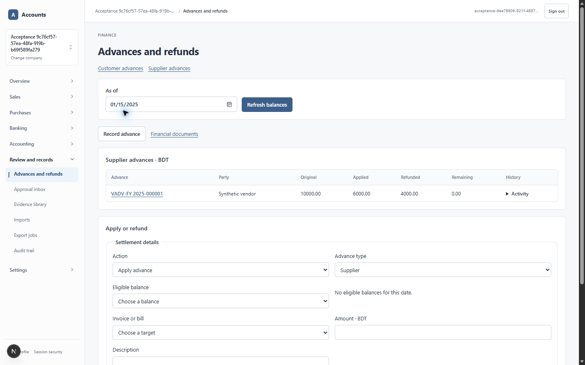

# Advance application and linked refund evidence

See the [QA report](../../advance-refund-settlements-2026-10-21.md) for scope and release limitations. Financial source: `46385464d1d8270f90c346450616c6bc765d7de4`. UI route source: `cc86a1fc3936fa26e70c7d51f7de3afe94da1778`. PR #185 is stacked on #184; these are isolated synthetic tests, not production changes or launch approval.

Private environment files, passwords, provider keys and recovery manifests remain in ignored `output/`. The publisher checks known private values before copying these receipts. Text copies normalize line endings and trailing whitespace only. Test names, counts, fixture IDs and failures/successes are not rewritten.

| Evidence | Command or browser operation | Boundary |
|---|---|---|
| `migrate-*.log` | `node scripts/db-migrate.mjs` | Forward migration receipts 0107–0115; final isolated database has 114 migration files |
| [all-advances-verified.log](all-advances-verified.log) | `npm run test:database:advances` | Final combined 7/7 after 0115; ordinary advances, imported advances/trade items, linked credits/refunds, capacity races and unlinked-refund denial |
| [accounting-regression.log](accounting-regression.log) | `npm run test:database:accounting` | 53/53; before the final metadata/opening extensions, disclosed in the report |
| [http-security.log](http-security.log) | `npm run test:database:http-security` | 5/5 real password/cookie tests against the loopback development server |
| [export-regression.log](export-regression.log) | `npm run test:database:exports` | Final 7/7 after 0115, including actual private object bytes and issued snapshots |
| [apply-alias-verified.log](apply-alias-verified.log) | Actual restricted-role `applyAdvanceCommand` smoke check | Same draft on replay; zero journal entries before posting |
| [unit-routes.log](unit-routes.log) | `npm test` | Latest 336/336 after canonical route changes and matrix update |
| [lint-routes.log](lint-routes.log), [typecheck-routes.log](typecheck-routes.log) | `npm run lint`; `npm run typecheck` | Passed after canonical route changes |
| [build-release.log](build-release.log) | `npm run build -- --webpack` | Local optimized financial implementation build passed before the route follow-up |
| [production-audit.json](production-audit.json) | `npm audit --omit=dev --json` | Zero production dependency vulnerabilities; parent development findings remain recorded |
| `candidate-capture.log`, `candidate-marker.log`, [candidate-restore.log](candidate-restore.log) | `recovery-database.mjs capture/verify` and the restricted restored lifecycle check | Final candidate historical restore: 70 tables, 114 migrations, 43 ledger groups, 53 linked details; later marker absent |
| [candidate-files.log](candidate-files.log) | Independent private-byte backup and conditional restoration into a new private bucket | All 10 files match; 2 PDFs readable; 8 revoked export requesters denied; database unchanged |
| `candidate-marker.mjs.txt`, `verify-candidate-recovery.mjs.txt`, `candidate-file-restore.mjs.txt` | Exact operational check source, copied as text for review | Requires ignored private configuration/assets; these copies are evidence, not a general production restore utility |
| `edge-maker-denied.txt`, `edge-checker-preview.txt` | Maker denied; different password-authenticated checker reviews source, target and posting preview | Synthetic role enforcement only; no independent human approval claimed |
| `edge-*-final.txt` | Final customer/supplier balances and corrected completed approval history | Both advances: 10,000 original, 6,000 applied, 4,000 refunded, zero remaining |
| `edge-lifecycle-route.txt`, `edge-new-advance-route.txt` | Direct supplier lifecycle URL; Record advance link | Correct tab/history; shared supplier draft form opens |
| `edge-desktop.png`, `edge-tablet.png`, `edge-phone.png`, `edge-phone-form.png` | Actual Edge surface screenshots at 1440×900, 768×1024 and 375×812 | User's existing 90% zoom preserved; no approved baseline or complete accessibility certification |

The final combined seven-case run supersedes the earlier six-case checkpoint. All raw exploratory logs remain privately retained; intermediate failures and repairs are explained in the QA report. This directory contains the final receipts rather than duplicate unit/static-check checkpoints.

The route source passed [GitHub CI](https://github.com/wdmahbubur/accounts-management-solution/actions/runs/39555568297), GitGuardian and the [Vercel preview build](https://vercel.com/wdmahbuburs-projects/accounts-management-solution-web/C2ZGiGjxjhknmBFD7wKJk5XvjSDL). The preview was not used as the E2E database target.

