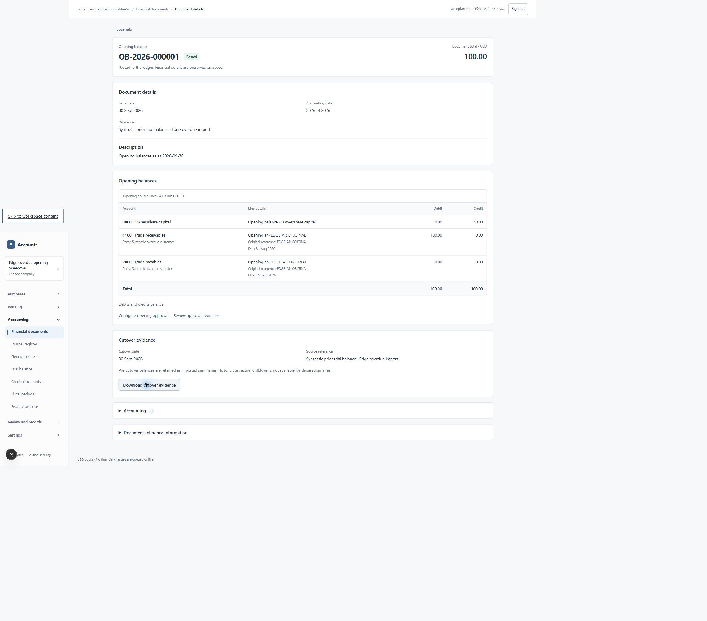

# Historical opening due dates — 24 October 2026

Implementation commits `bed24ae832fd5a4e3c4a1207b3edde27b47b4f3c` (date model), `4df581d88cc969e74a78d36079e2949a364dda2e` (complete export) and `8a57974d4509e88ad559767878b7d646e4771edb` (legacy HTTP write boundary). Scope #174 / #78 / #82; stacked on PR #194. Forward migrations **0128–0129** are applied only to isolated test databases.

The original PostgreSQL reproduction failed with `22023` in the control-item constructor while activating an approved overdue opening. Its transaction created no journal. The implementation retains the original AR/AP due dates and references, while the journal and open-item availability remain at `books_start_date - 1`. No prior invoices, revenue, expenses or allocations are invented. See [ADR 0006](../adr/0006-historical-opening-trade-dates.md) for the bounded accounting decision and labelled AI review.

0128 replaces the universal ordering constraint with finite-date validation plus a shared source-aware predicate, checked by the constructor, insertion trigger and deferred control-line check. Earlier due dates are allowed only for AR/AP on a genuine opening-balance journal at the company's cutover. Ordinary journals and other controls retain date ordering. No posted facts are rewritten and no private helper/DML privileges are granted. API calendar validation also rejects year zero, which JavaScript accepts but PostgreSQL does not.

Edge testing found the cutover download contained aggregate trial-balance evidence without the original control detail. 0129 extends that same read/export with source identity/version/state/currency and individual references, due dates, exact amounts and availability dates. It also requires the source to be readable. The older standalone summary-edit endpoint now checks origin, fresh company context and the same preparer capabilities as the atomic wizard.

| Check | Actual result |
| --- | --- |
| New overdue-opening suite | **7/7 passed** on each upgraded and fresh-install-lineage database; no skips |
| Existing company setup | **9/9 scenarios passed**: 6 rollback fixtures and 3 real two-connection races |
| Cutover/advance/refund regression | **11/11 passed**, no skips; YTD inclusion, zero suspense, dated settlements, locked periods, material approvals and overspend race |
| Application suite | **366/366 passed**, no skips |
| Lint / TypeScript / optimized build | Receipts attached |
| Auth.js HTTP suite | **15/15 passed**, no skips; includes foreign origin, stale company context, missing capability, foreign membership and anonymous legacy evidence-write denials |
| Actual Edge workflow | Create/edit opening draft → inspect original dates → submit → preview → explicit synthetic sole-owner approval → setup activation → posted source → evidence download: passed |

The new database cases include overdue/current/future and leap-day AR/AP, exact references, approval invalidation after a due-date edit, failed/retried activation without stray journals, pre-cutover empty history, post-cutover partial receipt, ordinary-journal ordering and tenant/capability/immutability denials. At cutover, AR **175.00** and AP **100.00** reconcile with zero differences. A receipt of **10.00** on the following day reduces AR to **165.00** and retains the prior dated **175.00** view. No nominal opening lines are created.

The Edge company is synthetic US/USD with New York timezone, books starting **1 October 2026**. The form retains AR original due **31 August** and AP original due **15 September**, posts one opening journal dated **30 September**, and downloads both original references/dates. Readback confirms AR **100.00**, AP **60.00**, one journal and zero control/subledger differences. The source version is **2** because the draft was edited before approval. Initial automated date-field filling changed the displayed native input without committing React state; actual keyboard events were then used, and saved source, approval material, posted rows and downloaded bytes were all checked. No production books or customer records were touched.



Exact commands:

```text
node --env-file=<private-isolated-profile> output/launch/2026-10-24/apply-pending.mjs 0128_historical_opening_trade_due_dates.sql
node --env-file=<private-isolated-profile> output/launch/2026-10-24/apply-pending.mjs 0129_complete_opening_evidence_export.sql
node --env-file=<private-isolated-profile> --conditions=react-server --test tests/database/opening-overdue.test.mjs
node --env-file=<private-isolated-profile> --conditions=react-server scripts/test-company-setup.mjs
node --env-file=<private-isolated-profile> --conditions=react-server --test --test-concurrency=2 tests/database/cutover-classification.test.mjs tests/database/advance-refund-settlement.test.mjs tests/database/opening-advance-settlement.test.mjs tests/database/refund-safety.test.mjs
AMS_TEST_APP_URL=http://localhost:3001 node --env-file=<private-isolated-profile> --conditions=react-server --test tests/database/http-security.test.mjs
npm run test:application
npm run lint
npm run typecheck
node --env-file=<private-isolated-profile> scripts/run-next.mjs build apps/web --webpack
```

PowerShell used a separate environment assignment. Each isolated migration verifies every earlier receipt/checksum and retains identical financial-table fingerprints. The second database was installed empty through 0124, then successively upgraded through 0129 with synthetic fixtures; it is not claimed to be an untouched 0129 installation. Integration tests use the restricted runtime login; administrative fixture setup creates synthetic parties/policies. The setup suite labels its privileged fault injections separately. An intermediate expansion of the tests corrected an approval-error expectation and a missing receipt allocation plan; these were test setup corrections, not waived product denials.

[Receipts](evidence/historical-opening-2026-10-24/README.md) preserve the initial failure, final tests, migrations, Edge observations and actual exported evidence. This is AI accounting/code/security review for the internal gate under #115, not independent accountant acceptance. It does not complete the dormant-year fix, load benchmark, production scheduler/scanner operation, full provider restore drill or worldwide tax/legal review. No production migration/deployment is authorized by this report. Billing and privileged support remain deferred.
