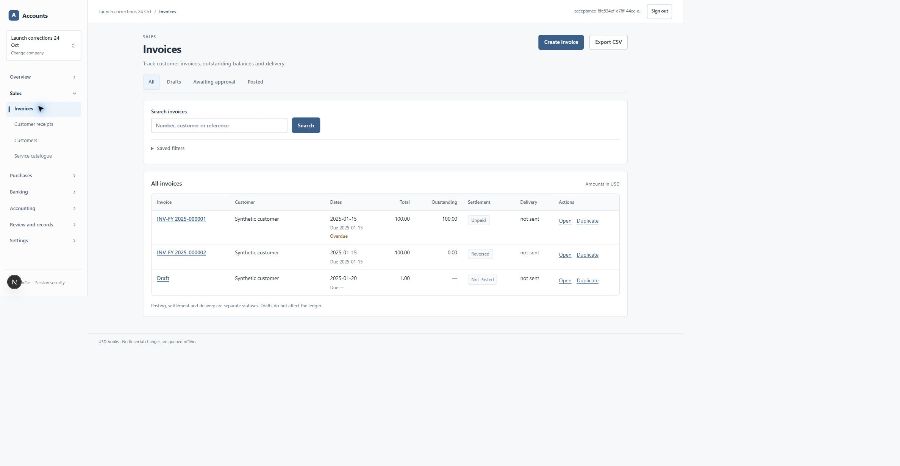

# Dated trade status and register readability — 24 October 2026

Implementation `daaa46189bf36d9f90e32ffe59e971385346dc54`. Focused follow-up for #177, #50 / US-030–031 and #52 / US-033–034, based on PR #198. This does not close those larger lifecycle stories or the worldwide launch gate.

Reversal closure previously made original invoices and supplier bills appear **Paid**. Migration **0131** changes the three existing register/invoice-lifecycle readers to show **Reversed** only when the linked posted reversal is effective by the company's local date. Future-dated originals show **Not yet effective**, no current outstanding amount and no overdue flag. Normal unpaid, partial and paid states retain the existing dated allocation calculation. Invoice detail now supplies its as-of date and hides the receipt shortcut when the current residual is unavailable. Original sources, issued snapshots, journals, allocations, correction links and grants are preserved.

The migration contains read-function replacements only, no table or financial-data rewrite. Canonical SHA-256: `a42ce0a1afb5f085873c9dc3188a88535544d93ffc3d53ff2b202cd5ab5bab68`. It was applied to the two isolated databases through the guarded receipt/checksum runner, with unchanged six-table financial fingerprints. The second database began empty through 0124 and was incrementally upgraded with synthetic fixtures through 0131; it is not represented as an untouched 0131 installation. Production remains at 0123.

Invoice and bill tables now reserve readable column space, keep document identifiers, dates and short statuses intact, and wrap customer/supplier descriptions separately. Overflow stays within the keyboard-focusable table region. No values or actions were removed.

| Check | Actual result |
| --- | --- |
| New register suite, upgraded isolated database | **10/10 passed**, no skips |
| New register suite, fresh-install lineage database | **10/10 passed**, no skips |
| Existing golden books and reversal dependencies | **20/20 passed**, no skips; includes independent-connection races |
| Application suite | **373/373 passed**, no skips |
| ESLint / TypeScript / optimized build | Passed; receipts attached |
| Actual user Edge | Invoice matrix at **320, 390, 768, 1440 CSS px**, all at 760 CSS px height; no page overflow, single-line identifiers/dates/statuses, reachable Open/Duplicate actions |
| Additional Edge flows | Invoice search and reversed detail, retained issued snapshot/correction history, supplier register at 320/1440, Duplicate opening the copied supplier editor; no copied draft saved |

Database cases exercise drafts, unpaid/partial/full settlement, current/future reversals, future sources, company timezone boundaries, list/detail agreement, filter/search/cursor behavior, outsider/revoked-role denials, unchanged journals and zero AR/AP control bridges. No new financial command or lock protocol is introduced by this read-model fix. Existing posting/reversal/race behavior is covered by the separate regression receipt.

The Edge fixture temporarily lengthened one synthetic contact-directory name. The immutable issued invoice still showed its original customer snapshot. The directory name was restored and all six financial-table fingerprints remained unchanged. No production records, real email recipients or real financial transactions were used.

The browser remained at its existing **75% zoom**. The browser-level viewport control did not itself produce the requested CSS widths, so the supported tab CDP capability supplied temporary desktop metrics, adjusted for that zoom; every width was checked with `innerWidth`. This is desktop CSS reflow evidence, not touch/device emulation or the original issue's differing-zoom matrix. Temporary overrides were cleared. [Measured matrix](evidence/trade-register-2026-10-24/edge-matrix.json) includes settled keyboard-focus action positions; an earlier immediate sample was taken while horizontal scrolling was still moving. The search command's final observation timed out, but the next DOM observation confirmed the actual filtered result; it was not blindly resubmitted. Real phones, Safari and screen readers were not tested.



Screenshots: [320](evidence/trade-register-2026-10-24/register-invoice-320.png), [390](evidence/trade-register-2026-10-24/register-invoice-390.png), [768](evidence/trade-register-2026-10-24/register-invoice-768.png), [1440](evidence/trade-register-2026-10-24/register-invoice-1440.png), [320 row actions](evidence/trade-register-2026-10-24/register-invoice-320-actions.png), [supplier 320](evidence/trade-register-2026-10-24/register-bill-320.png), [supplier 1440](evidence/trade-register-2026-10-24/register-bill-1440.png), [invoice detail](evidence/trade-register-2026-10-24/register-invoice-detail.png). These contain synthetic data and were visually inspected before publication.

Exact terminal checks (profiles are ignored, private local files):

```text
node --env-file=output/recovery/2026-10-21/final.private.env output/launch/2026-10-24/apply-pending.mjs 0131_trade_register_effective_status.sql
node --env-file=output/launch/2026-10-24/fresh.private.env output/launch/2026-10-24/apply-pending.mjs 0131_trade_register_effective_status.sql
node --env-file=output/recovery/2026-10-21/final.private.env --conditions=react-server --test tests/database/trade-register-status.test.mjs
node --env-file=output/launch/2026-10-24/fresh.private.env --conditions=react-server --test tests/database/trade-register-status.test.mjs
node --env-file=output/recovery/2026-10-21/final.private.env --conditions=react-server --test --test-concurrency=2 tests/database/golden-books.test.mjs tests/database/reversal-dependencies.test.mjs
npm run test:application
npm run typecheck
npm run lint
node --env-file=output/recovery/2026-10-21/final.private.env scripts/run-next.mjs build apps/web --webpack
node --env-file=output/recovery/2026-10-21/final.private.env output/launch/2026-10-24/edge-register.mjs long
node --env-file=output/recovery/2026-10-21/final.private.env output/launch/2026-10-24/edge-register.mjs restore
node output/launch/2026-10-24/publish-register.mjs
```

`npm run test:database:trade-register` is also available; provision an isolated owner/runtime profile before invoking it. Native Node `--env-file` variables are not assumed to carry into a separate npm child.

The initial red run reproduced both **Paid → Reversed** defects. It also gave the future-source fixture a due date before its accounting date; the existing database guard correctly rejected that fixture with `22023`. After correcting its due date, both database runs passed. A final repeat additionally made the fixture safe on early-January dates; the adjacent-year calendar branch is administrative test setup only. The initial failure receipt is retained. The first browser-fixture preparation rejected a nonexistent organization display-name column before mutation; it was corrected to the actual `name` column before the successful preparation/restoration receipts.

This is AI accounting/security/code review under #115, not an independent accountant certification. It does not establish a new provider recovery drill, measured 100-company capacity, the next-fiscal-calendar creation flow, worldwide statutory compliance, or production deployment. Billing and privileged support remain deferred. At the owner's latest instruction, **production background-job activation stays pending until capacity is arranged**. No Azure resize, server credential installation, production migration or production deployment occurred. A forward-only read-function correction is the rollback approach if needed; do not restore older books over newer committed accounting records.
