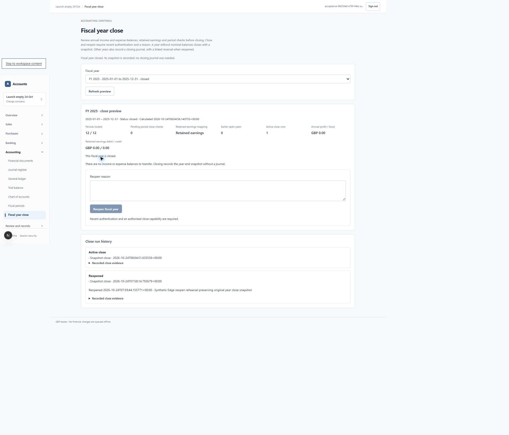

# Zero-nominal fiscal-year close — 24 October 2026

Implementation `e25b80e5e7080600de506470346a70b4ad126d75`. Scope #176 / #86 / US-061; based on PR #195. Migration **0130** is applied only to the two isolated test databases. Its canonical SHA-256 is `45bbd61f828d4750eeb29ec0ecc5d5926585f5519a6d6ed1a044954be95a4365`.

An empty year previously failed close despite all twelve periods being locked, valid retained earnings mapping and zero failed checks. The reproduced `23514` rejection left no journals. Snapshot-only close/reopen now records immutable evidence, reason, actor and date without a fabricated document, number, journal or retained earnings transfer. Nonzero nominal balances retain normal journal closing, including offsetting income/expenses whose net profit is zero. See [ADR 0007](../adr/0007-zero-nominal-year-close.md).

The one-active-run index recognizes both journal reversals and snapshot reopen events. The append-only guard protects original snapshot data and permits one reopen event. Existing period/year locks, capability/recent-authentication checks, chronological ordering, exact amounts and idempotent receipts remain in force. HTTP writes now reject foreign origins and stale company nonces. The screen checks the actual receipt kind before reporting success, prevents duplicate submissions immediately and retains uncertain in-page attempts for an identical key/payload retry. It does not claim durable browser retry storage across reloads.

| Check | Actual result |
| --- | --- |
| New database suite, upgraded database | **10/10 passed**, no skips |
| New database suite, fresh-install lineage | **10/10 passed**, no skips |
| Existing accounting/period/year/reversal regression | **27/27 passed**, no skips |
| Actual Auth.js HTTP suite | **16/16 passed**, no skips; origin/context/capability/tenant/anonymous denials and successful snapshot close/reopen receipt replays |
| Application tests | **368/368 passed**, no skips |
| Lint / TypeScript / optimized build | Passed; receipts attached |
| Actual Edge | Existing-password session confirmation, GBP company, duplicate-click close, reopen, prerequisite relock, reclose, history and restricted database readback passed |

Database cases cover dormant, balance-sheet-only and fully reversed years; genuine zero-net and loss journals; missing prerequisites/permissions/recent authentication; tenant denial; unchanged reports and source/open-item/allocation facts; original history protection; independent same-key and different-key connections; consecutive-year close/reopen ordering and races. The adjacent-year calendar in the race test is administrative synthetic fixture setup, not evidence of a public next-calendar creation flow. Browser evidence covers the dormant GBP case; the other modes are real restricted-role database cases, not additional browser sessions.

The Edge company retains **zero documents and zero journals**, two immutable close runs with one reopened and one active, and an unchanged first snapshot. Period locks were prepared through the existing restricted RPCs; this is not a claim of twelve individual browser lock submissions. The browser used an actual password confirmation rather than a fabricated recent-authentication session.



Exact commands:

```text
node --env-file=<private-isolated-profile> output/launch/2026-10-24/apply-pending.mjs 0130_zero_nominal_year_close.sql
node --env-file=<private-isolated-profile> --conditions=react-server --test tests/database/zero-nominal-year-close.test.mjs
node --env-file=<private-isolated-profile> --conditions=react-server --test --test-concurrency=2 tests/database/period-year-controls.test.mjs tests/database/accounting-guards.test.mjs tests/database/reversal-dependencies.test.mjs
AMS_TEST_APP_URL=http://localhost:3001 node --env-file=<private-isolated-profile> --conditions=react-server --test tests/database/http-security.test.mjs
npm test
npm run lint
npm run typecheck
node --env-file=<private-isolated-profile> scripts/run-next.mjs build apps/web --webpack
node --env-file=<private-isolated-profile> output/launch/2026-10-24/edge-year.mjs verify
```

PowerShell assigned the HTTP environment variable separately. Each migration verifies all prior receipts and unchanged financial-table fingerprints. The second database was installed empty through 0124, then successively upgraded with fixtures through 0130; it is not claimed to be an untouched 0130 installation. Two initial dynamic-patch attempts failed transactionally and were corrected before any migration receipt was committed. The first new-suite run passed eight cases on each database and failed two test assertions because JSONB numeric values were treated as strings; the final assertions use exact PostgreSQL `sum(... )::text` for both journal sides. Those failed receipts remain attached. A repeated local lint/typecheck command encountered an overlapping log-file handle; the accepted lint, typecheck and build receipts were subsequently captured without a product failure.

This is labelled AI accounting/security/code review under #115. It does not establish independent accountant certification, a new full provider recovery drill, measured 100-company capacity, production job/scanner operation, the next-calendar creation UI, all browser permutations, worldwide tax/legal acceptance, or production migration/deployment authorization. Billing and privileged support remain deferred. Original production books are unchanged.
